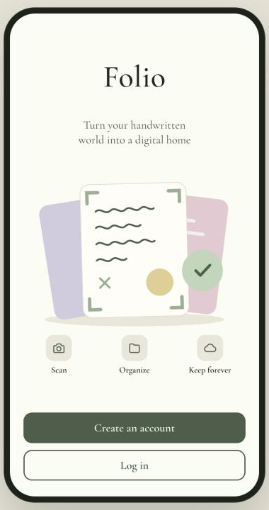
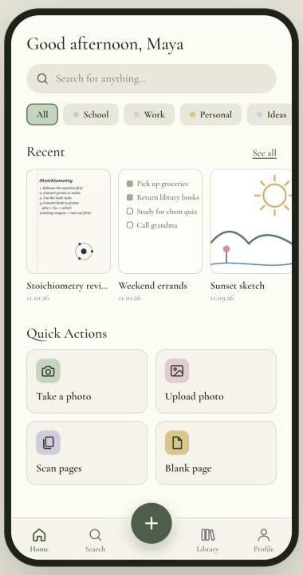
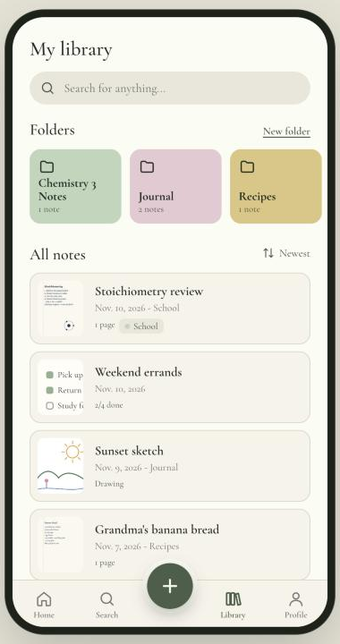
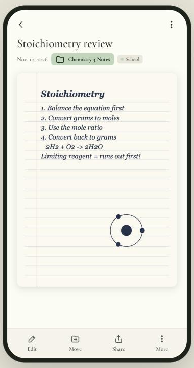
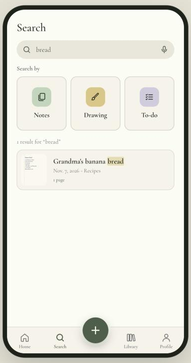

# Folio

**Turn your handwritten world into a digital home.** · [Website](https://katyarouault.github.io/folio/) · [Privacy](https://katyarouault.github.io/folio/privacy.html) · [Support](https://katyarouault.github.io/folio/support.html)

Folio is an iPhone app for people who still think on paper. Snap a page of class notes, a recipe card or a sketch, and Folio cleans it up, files it into folders and tags, and makes it searchable. You can also draw and make to-do lists inside the app.

I designed Folio in Figma, from wireframes to a mid-fidelity prototype, then built it as a working app with its own accounts, cloud sync and an App Store build.

<p>
  
  
  
  
  
</p>

## Features

- **Scan pages:** take a photo or upload one, drag the corners to crop (or let Auto find the page), and scan several pages into one note.
- **Clean up handwriting:** the "Cleaned" mode whitens the paper and sharpens the ink. Filters and adjustments like brightness and contrast are there too, and you can re-edit any page later.
- **Draw and list:** a drawing canvas with coloured pens and an eraser, plus to-do lists with checkboxes.
- **Organize:** folders, colour tags, sorting, and duplicating or moving notes.
- **Search:** search across titles, tags and folders, with matches highlighted.
- **Accounts:** sign-up with an emailed 6-digit code, password reset by code, a profile photo, and deleting your account from inside the app.
- **Personal:** light and dark themes, accent colours and text size.
- **AI (prototype build):** ask AI to find notes by meaning, read handwriting, restyle a photo, or redraw a sketch.

## How it's built

| Layer | Tech |
| --- | --- |
| Design | Figma: wireframes, a mid-fidelity prototype and the design tokens behind the colours and type |
| App | Vanilla JavaScript single-page app with no framework, and image processing (cropping, cleanup, filters) on HTML canvas |
| Backend | [Supabase](https://supabase.com): Postgres with Row Level Security, Auth with email codes, and Storage for page images |
| Email | Custom SMTP for sign-up and password-reset codes |
| iOS | [Capacitor](https://capacitorjs.com) wraps the app as a native iPhone app, built and shipped with Xcode |
| Offline | IndexedDB cache, so the library opens instantly and keeps working without a connection |

The same code runs two builds:

- **`index.html`** is the App Store build. It loads Supabase, so accounts, notes and photos sync to the cloud.
- **`folio.html`** is a prototype build that runs inside claude.ai and adds the AI features.

## Project structure

```
app.js               app logic: screens, image processing, storage, auth
styles.css           design system and components
index.html           App Store build (Supabase)
folio.html           prototype build (claude.ai)
supabase-setup.sql   tables, Row Level Security policies, storage bucket, delete-account function
setup-ios.sh         builds the Capacitor iOS project and opens Xcode
docs/screenshots/    images for this README
```

## Run it locally

```sh
python3 -m http.server 5173
# open http://localhost:5173/index.html
```

To build the iPhone app you need Xcode and Node.js LTS:

```sh
sh setup-ios.sh
```

## Privacy and security

- Row Level Security means each person can only read and change their own notes and images.
- Only the Supabase **publishable** key ships in the app. It's built to be public, and the database rules do the protecting.
- Deleting an account removes the person's images, notes and login.

## What I learned

- Taking a design from a Figma prototype to a working product, and the decisions that only show up once real people tap through it.
- How a frontend, a backend and an email service fit together, and why an app can't send email by itself.
- Database security with Row Level Security, and which keys are safe to ship versus which must stay secret.
- What Apple requires before App Store review: in-app account deletion, a privacy policy, permission messages and native features.

## Status

The design is done, the app works, and the backend is live. Next up: iOS build testing and App Store submission.

---

Designed and built by **Katy Rouault**. Questions: folionotes.help@gmail.com
